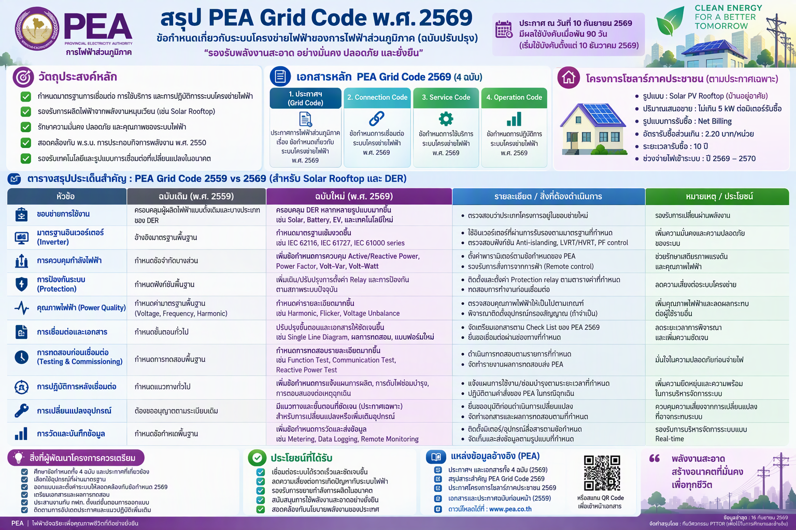
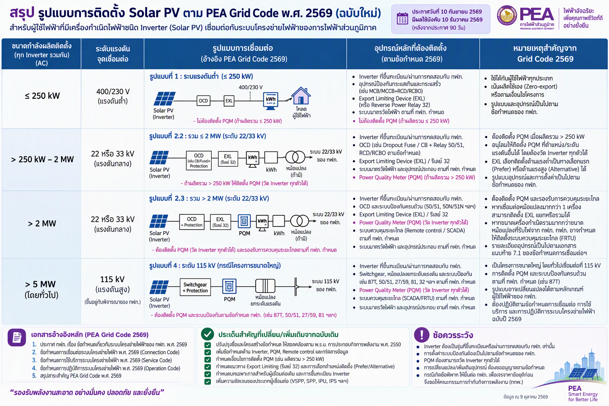

# PEA Grid Code พ.ศ. 2569 — คู่มือสำหรับ Solar PV

**Solar Rooftop · Solar Farm · Grid Connection · Engineering Review**

คู่มือ Markdown ภาษาไทยสำหรับเปิดอ่านบน **GitHub** ใช้ประกอบงานออกแบบระบบไฟฟ้า การประเมิน TOR/BOQ การตรวจแบบ (Design Review) และการเตรียมทดสอบก่อนเชื่อมต่อกับการไฟฟ้าส่วนภูมิภาค (กฟภ.) โดยจัดระเบียบจากไฟล์ HTML และอินโฟกราฟิก **2 ภาพที่แนบมา**

**ชุดข้อมูลในคู่มือนี้:** 51 ข้อใน Engineering Compliance Matrix · 34 ค่าพิกัด/เงื่อนไข · 25 ข้อใน Site Checklist · 6 ตัวอย่างข้อกำหนด TOR

> **หมายเหตุด้านการใช้งาน:** เนื้อหานี้เรียบเรียงจาก HTML และภาพสรุปที่แนบมา ไม่ใช่ประกาศหรือหนังสืออนุมัติอย่างเป็นทางการของ กฟภ. ก่อนนำตัวเลข/ข้อกำหนดไปใช้ใน TOR, BOQ, งานออกแบบ หรือยื่นเชื่อมต่อ ให้ตรวจเอกสาร กฟภ. ฉบับเต็มและหนังสืออนุมัติเฉพาะโครงการอีกครั้ง

## เริ่มอ่านจากตรงไหน

| ต้องการทำอะไร | ไปที่เอกสาร |
|---|---|
| เข้าใจ Grid Code และเลือกรูปแบบ Solar Rooftop/Farm | [01 — ภาพรวมและการเชื่อมต่อ](docs/01-overview-and-connections.md) |
| ตรวจค่า kW, kV, PQM, Protection, Frequency และระยะเวลา | [02 — ตารางค่าพิกัดสำคัญ (34 รายการ)](docs/02-key-thresholds.md) |
| ตรวจความครบถ้วนของงานออกแบบ/จัดซื้อ/ติดตั้ง | [03 — Compliance Matrix (51 รายการ)](docs/03-compliance-matrix.md) |
| ใช้เป็นรายการตรวจที่หน้างานและก่อนส่งมอบ | [04 — Site Inspection Checklist (25 รายการ)](docs/04-site-inspection-checklist.md) |
| คัดลอกร่างข้อความสำหรับ TOR หรือ Specification | [05 — ตัวอย่างข้อกำหนด TOR (6 หมวด)](docs/05-tor-specification-templates.md) |
| ดูขอบเขตแหล่งข้อมูล และวิธีแก้ไขคู่มือ | [06 — อ้างอิงและวิธีปรับปรุง](docs/06-sources-and-maintenance.md) |

## ภาพที่ 1 — สรุป PEA Grid Code 2569

เน้นวัตถุประสงค์ เอกสารหลัก 4 กลุ่ม และสรุปประเด็นเปลี่ยนแปลงใน Grid Code สำหรับ Solar PV และ Distributed Energy Resources (DER)

[เปิดไฟล์ภาพที่ 1](images/01-pea-grid-code-2569-overview.png)

## ภาพที่ 2 — รูปแบบการติดตั้ง Solar PV และการเชื่อมต่อ

แสดงตัวอย่างการเชื่อมต่อระดับแรงดันต่ำ **400/230 V**, ระดับแรงดันกลาง **22/33 kV** และแรงดันสูง **115 kV** รวมถึงตำแหน่งอุปกรณ์ประกอบ เช่น **OCD, EXL, PQM และ Metering**

[เปิดไฟล์ภาพที่ 2](images/02-pea-solar-pv-connection-patterns.png)

> **ข้อควรอ่านควบคู่ภาพ:** อินโฟกราฟิกเป็นการสรุปแบบย่อ ไม่ใช่แบบเชื่อมต่อที่อนุมัติสำหรับโครงการจริง รูปแบบอุปกรณ์ต้องตรวจจาก Annex 7.1 ของ Connection Code และเงื่อนไข กฟภ. ที่ใช้กับโครงการนั้น

## สรุปหัวข้อสำคัญสำหรับวิศวกร

| ประเด็น | ข้อมูลจากเอกสารแนบ | ใช้ตัดสินใจอะไร |
| --- | --- | --- |
| วันที่เริ่มใช้ตามไฟล์สรุป | 10 ธ.ค. 2569 | ควรตรวจบทเฉพาะกาลและสถานะล่าสุด |
| ประเภทโครงการ | IPU / IPS / VSPP / SPP | ประเภทการใช้ไฟและการส่งออกต่างกัน |
| ขนาดที่ใช้พิจารณา | DC kWp / Inverter AC kW / Export Cap | เป็นคนละค่า ห้ามใช้แทนกัน |
| Power Quality Meter (PQM) | Inverter รวม > 250 kW | ตรวจเงื่อนไขเพิ่มตามระดับแรงดัน/รูปแบบ |
| SCADA / Remote control | ขึ้นกับรูปแบบการเชื่อมต่อ | ไม่บังคับเหมือนกันทุกโครงการ |
| ขั้นตอนก่อนจ่ายไฟ | Design → PEA Approval → Test → Energize | ตรวจอุปกรณ์และหลักฐานการทดสอบให้ครบ |

### วิธีใช้งานกับโครงการจริง

1. **ระบุ Project Basis** — แยกประเภท IPU/IPS/VSPP/SPP, จุด PCC, ระดับแรงดัน, กำลังแผง DC, กำลัง Inverter AC และกำลังส่งออกที่ได้รับอนุญาต
2. **เลือกรูปแบบการเชื่อมต่อ** — ตรวจการจัดกลุ่มตาม Annex 7.1 และแบบที่ กฟภ. เห็นชอบ
3. **ตรวจ Matrix และค่าพิกัด** — ทบทวน Protection, Anti-Islanding, EXL, PQM, Monitoring, SCADA ตามเงื่อนไขที่เกี่ยวข้อง
4. **ผูกเข้ากับ TOR/BOQ และแบบ** — ระบุรายการอุปกรณ์ ความรับผิดชอบ หลักฐาน และงานทดสอบ
5. **ตรวจรับและส่งมอบ** — ใช้ Checklist ร่วมกับ approved drawing, setting sheet, commissioning report และเอกสาร กฟภ.

## ชุดไฟล์สำหรับนำไปใช้งาน

- ไฟล์ Markdown ทุกบทอยู่ใน [`docs/`](docs/)
- ภาพอินโฟกราฟิกจริง 2 ภาพอยู่ใน [`images/`](images/)
- ข้อมูลตารางแบบ CSV (UTF-8 BOM เปิดใน Excel ได้) อยู่ใน [`data/`](data/)
- HTML ต้นฉบับ (แบบ interactive เมื่อเปิดในเบราว์เซอร์) อยู่ใน [`source/`](source/PEA_Grid_Code_2569_Solar_Engineering_Guide.html)

**Revision:** Markdown edition 31 ต.ค. 2569 · เอกสาร HTML ระบุ Rev. 22 ต.ค. 2569

> คำย่อ: **C** = Connection Code · **S** = Service Code · **O** = Operation Code · **PCC** = Point of Common Coupling · **PQM** = Power Quality Meter · **EXL** = Export Limiting Device
